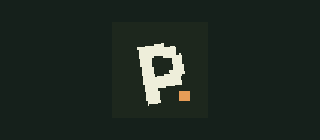
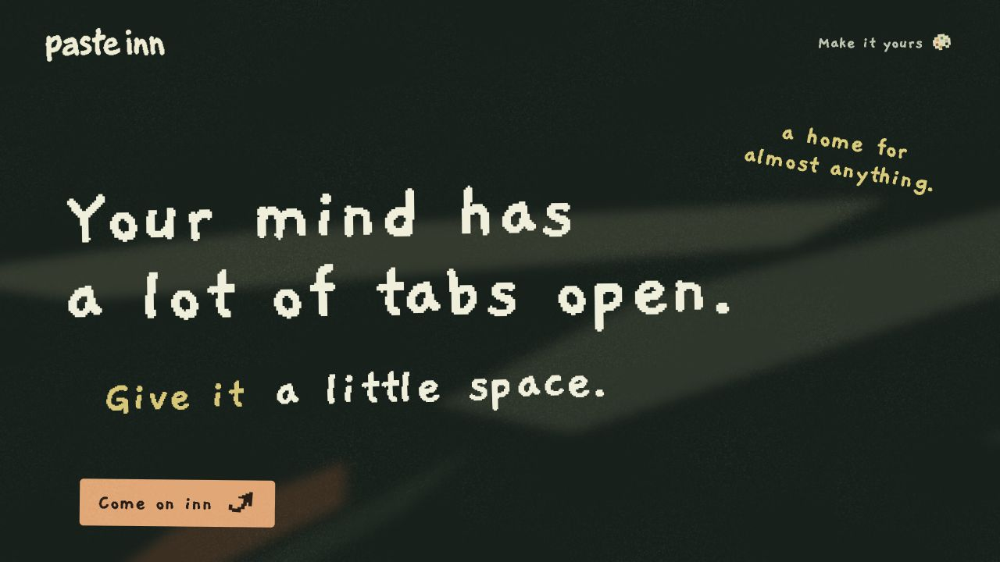

<p align="center">
  
</p>

<h1 align="center">paste inn</h1>
<p align="center">Your mind has a lot of tabs open.<br><strong>Give it a little space.</strong></p>



A cozy little home for things you want to keep. Copy something. Paste it inn. Find it when you need it.

### Come on inn

- **Keep anything.** Links, notes, screenshots, photos and voice recordings.
- **Find it again.** Search notes, image text and voice transcripts.
- **Make a crate.** Pick an icon, draw your own, give it a color.
- **Make it yours.** Quiet grain, drifting paper and compact or roomy cards.

Your saves live on your device first. Optional encrypted GitHub sync lets you bring them to another device. Install it as a web app on your phone or desktop.

<p align="center"></p>

### Run locally

No build step. Serve `dist/` with any static web server, or use the included preview:

```sh
python3 -B server.py --port 4174
```

Open [the inn](http://127.0.0.1:4174/concept.html) or [the landing page](http://127.0.0.1:4174/landing.html).

### Still settling in

An early, evolving project. GitHub sync is experimental and unaudited. Audio/video files stay on the capture device; transcripts can sync. Rich link previews currently need the development helper. Native apps and advanced sharing are future work.

[Development & setup](docs/development.md) · [Storage protocol](docs/storage-protocol.md) · [Design notes](docs/design-direction.md)

<sub>Made for the little things worth keeping. Pixel lettering, Lucide icons, and a little orange dot.</sub>
