[https://pasteinn.com/landing.html](https://pasteinn.com/landing.html)

  

<h1 align="center">paste inn</h1>

Your mind has a lot of tabs open. <strong>Give it a little space.</strong>

A cozy little home for things you want to keep. Copy something. Paste it inn. Find it when you need it.

### Come on inn

- **Keep anything.** Links, notes, screenshots, photos and voice recordings.
- **Find it again.** Search notes, image text and voice transcripts.
- **Make a crate.** Pick an icon, draw your own, give it a color.
- **Make it yours.** Quiet grain, drifting paper and compact or roomy cards.

Your saves live on your device first. Optional encrypted GitHub sync lets you bring them to another device. Install it as a web app on your phone or desktop.

### Come on over

[Open Paste Inn](https://pasteinn.com) · [Go straight to your inn](https://pasteinn.com/concept.html)

No installation, build step or Python required. The app runs in your browser, hosted on GitHub Pages.

### Something missing?

Let me know if you need a feature or run into an issue. [Leave a note here](https://github.com/evrenucar/pasteinn_app/issues).
