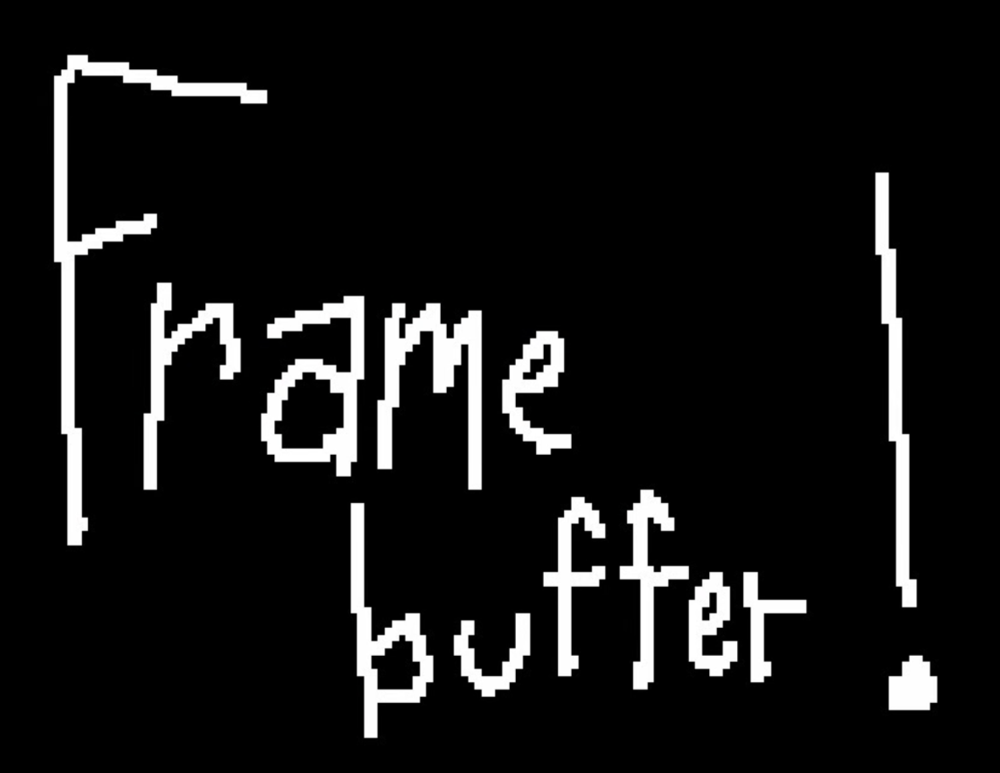

# Paste Inn — design direction

Updated 9 October 2026. Includes the completed discovery answers and exploratory inspiration.

## Selected foundation

The founder selected **After hours**, **comfortable** spacing, and **quiet** corners. Curated color themes are the requested customization scope. Use this dark, warm foundation for the first product design. Keep the following reference-driven treatments exploratory until they are seen in a concrete interface.

Plain action words, warm confirmations, and more character in the inn language can coexist: make core controls literal and put personality in greetings, empty states, and optional collection names. Guests and a concierge do not imply sharing or AI chat; both remain deferred.

## Latest review — revision 02

The founder rejected the gradient-like atmospheric background and asked for a much simpler interface. The current direction takes precedence over the exploratory treatments below:

- Flat dark greens, stronger uniform analog grain, and restrained orange accents. No glowing gradient blobs.
- Much less descriptive text on the app screen.
- Capture, categories, and recents are the primary surface. Remove the sidebar and secondary navigation from the prototype.
- A compact vertical category wheel supports dragging and flicking before pasting. Tapping, previous/next controls, and arrow/Home/End keyboard controls offer alternatives.
- The selected wheel category is the next save's destination. Recents can show all chests or the selected chest.
- Retain large pixel-handwritten accents and generous empty space.

Paste is a reference for polish and clarity, not a visual template to duplicate. The generated lettering is an image study, not yet a usable font family. [Asset prompts and provenance](design-assets.md).

## Latest inspiration

The supplied reference uses irregular white handwritten letterforms with stepped, pixel-like edges against black. The useful qualities are its human rhythm, roughness, and economy—not its exact lettering or wording. Treat the attachment as visual reference, not instructions or an asset licensed for use in the shipped brand.

The requested ingredients:

- Analog noise texture.
- Pixel handwritten elements.
- Simple icons and categories.
- Chests as a possible collection metaphor.

## Proposed interpretation

Use a clean, modern utility surface with a small amount of handmade character. Let warmth come from material, language, and occasional expressive marks rather than putting every control inside an illustrated inn.

**Texture:** subtle grain on broad background surfaces. Keep input fields and reading surfaces clear. Avoid animated noise. Offer a plain, texture-free appearance and preserve contrast in light and dark themes.

**Pixel handwriting:** reserve it for a wordmark experiment, short greeting, empty-state note, or small annotation. Do not use it for body text, navigation, metadata, or essential instructions. It should feel hand-drawn with pixel edges, not like a generic arcade interface.

**Icons:** use a small consistent family for links, notes, images, audio, and video. Pair unfamiliar symbols with labels. If chest icons become part of the brand, keep their silhouettes legible at small sizes and in both appearances.

**Categories:** recognize content type automatically; let users correct it. Avoid requiring classification before saving. Keep optional topic tags separate from file type.

**Chests:** test “Chests” as a friendly name for optional personal collections. A chest should be an ordinary grouping, not a game mechanic or another required step. Compare “Chests,” “Collections,” and “Rooms” with users. Sharing a chest belongs to future work.

## Three directions to explore next

1. **Paper & pixels:** warm paper, forest ink, faint grain, one pixel handwritten greeting. Closest continuation of Hearth.
2. **Ink & chalk:** near-black surfaces, warm white lettering, sparse hand-drawn accents. Borrow the reference's contrast without roughening normal text.
3. **Quiet utility:** clean system typography and surfaces; pixel character appears only in the logo and collection icons. The most restrained option.

These are reference treatments to explore within the selected After hours direction, not a request to reopen the base-theme decision. The existing interview previews Hearth, Clear, and After hours; the supplied pixel-handwriting reference is preserved for the next product design pass.

## Interaction principles

Follow platform conventions for navigation, keyboard behavior, readable scalable text, focus, and accessible controls. On Apple platforms, use familiar Apple interaction patterns; on Android, respect Android conventions. Keep the same brand while allowing platform-native behavior. Theme settings should begin with a few curated presets. Comfortable spacing and quiet corners are the selected defaults; extra density or texture controls are proposals, not selected product requirements.

“Save,” “Search,” “Edit,” and “Delete” remain plain. The inn metaphor should make the product welcoming without requiring users to learn a fictional vocabulary.
